<div align="center">

# 🪐 Exoplanet Atlas

### Exoplanet Detection & False-Positive Recycling in TESS Light Curves<br>using XGBoost and Physics-Based Vetting

*Finds transiting planets in NASA TESS data, and when a signal is **not** a planet,<br>works out what it really is instead of throwing it away.*

[](https://github.com/AIML-Miniproj/AIML_Exoplanet/actions/workflows/ci.yml)


[**Overview**](#-overview) · [**The app**](#-the-app) · [**Architecture**](#-system-architecture) · [**Pipeline**](#-the-pipeline) · [**Results**](#-results) · [**Run it**](#-getting-started) · [**Model card**](docs/MODEL_CARD.md) · [**Models explained**](docs/MODELS_EXPLAINED.md)

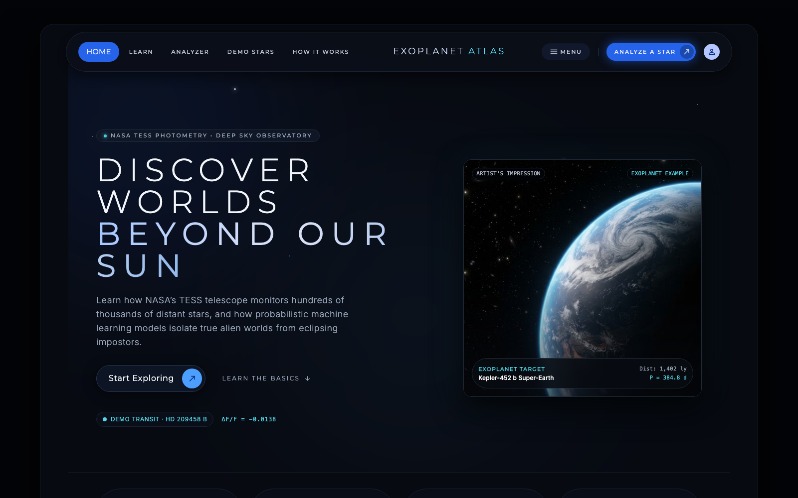

</div>

---

## 📑 Table of contents

1. [Overview](#-overview)
    - [What's new](#-whats-new)
2. [Highlights](#-highlights)
3. [The app](#-the-app)
4. [System architecture](#-system-architecture)
5. [The pipeline](#-the-pipeline)
6. [Dataset](#-dataset)
7. [Features](#-features)
8. [Model and training](#-model-and-training)
9. [Results](#-results)
10. [Explainable AI](#-explainable-ai)
11. [Technology stack](#-technology-stack)
12. [Project structure](#-project-structure)
13. [Getting started](#-getting-started)
14. [Rebuilding everything](#-rebuilding-everything-from-scratch)
15. [MLOps, testing and CI](#-mlops-testing-and-ci)
16. [Deployment](#-deployment)
17. [Limitations](#-limitations)
18. [Future scope](#-future-scope)
19. [References](#-references)
20. [Credits and acknowledgements](#-credits-and-acknowledgements)

---

## 🔭 Overview

**The problem.** Most known exoplanets were found with the *transit method*: when a
planet crosses the face of its star, the star dims slightly, once per orbit. NASA's
**TESS** satellite records the brightness of hundreds of thousands of stars in 27-day
*sectors*, so it sees these repeating dips constantly. But a dip is not proof of a
planet. **Eclipsing binaries** (two stars eclipsing each other), **variable stars**
(pulsations, starspots) and **instrumental noise** all produce look-alike dips, and a
large share of TESS candidates turn out to be such false positives. Vetting them by
eye does not scale.

**What this project does.** An end-to-end pipeline takes any star, downloads its
multi-sector TESS light curves, cleans them without damaging transits, searches for
periodic dips with **Box Least Squares**, and describes the strongest signal with
**56 physically meaningful features**. A calibrated **four-class XGBoost** model
(planet, eclipsing binary, variable star, noise) then makes a call, which a
**physics router** can overrule. Instead of discarding non-planets, every signal is
**recycled** into a dedicated module that reports what it really is: a planet's size
and orbit, a binary's true period and configuration, or a variable star's type.

**Why it matters.** Deep-learning vetters reach high accuracy but need thousands of
labelled examples and answer only *planet or not*. This project shows that a small,
carefully labelled dataset (**400 stars**) combined with domain knowledge gives a
useful, **multi-class and explainable** triage tool. Every verdict comes with
calibrated probabilities and plain-English reasons.

> **Problem statement:** design and implement a machine-learning pipeline that takes
> the TESS light curve of any star, detects periodic dips, classifies the strongest
> signal as planet, eclipsing binary, variable star or noise with calibrated
> confidence, explains the decision, and characterises the object instead of
> discarding non-planet signals.

---

## 🆕 What's new

The latest round of work (October 2026) quadrupled the training set, added flare
detection and brought the app up to date.

| Change | Details |
|---|---|
| **400 training stars** (was 100) | 100 per class, same catalogs and scripts. Macro-F1 **0.87 ± 0.05** (was 0.76 ± 0.10); every class improved, noise most (F1 0.66 → 0.81), and the spread between folds halved |
| **Two more classifiers** | SVM (RBF kernel, macro-F1 0.80) and k-nearest neighbours (0.71) evaluated on the same folds with accuracy, precision, recall, F1, PR-AUC, log loss, per-class F1 and confusion matrices (`scripts/compare_classifiers.py`); shown in the app's Model comparison table and on the How It Works page |
| **Ensembles tested** | Soft, weighted soft (nested weights) and hard voting, plus seed-bagged XGBoost (`scripts/compare_ensembles.py`, and soft voting in `src/triage/train.py`); none beat XGBoost alone, which is kept for its exact per-star explanations |
| **Optimisation** | Hyperparameter tuning with RandomizedSearchCV in nested CV (`scripts/tune_xgboost.py`): 0.84 vs 0.87, hand-chosen settings kept. Feature selection by SHAP ranking and recursive elimination in nested CV (`scripts/select_features.py`): no gain, 40 of 56 features already enough; the curve is shown in the app |
| **Flare detection** | New `src/recycler/flare_module.py`: finds flares on the uncleaned light curve, with physical guards against eclipses, Cepheid rises, pulsation peaks and binaries' repeating bumps. 3 flare stars among the 400 (all cool dwarfs); about 9 in 10 flares of ~1 % recovered in injection tests. Shown in the Analyzer's Results tab and as markers on the raw light curve; not a model input |
| **Bug fixes** | BLS no longer crashes when data gaps leave the twice-the-period test empty (`src/detect/bls.py`); a non-numeric value in the sector 89 target list is handled (`src/ingest/catalogs.py`); failed stars now report where they failed (`src/triage/dataset.py`) |
| **Clearer explanations** | A clear second eclipse is now listed as the first reason even when the model already says "binary" (`src/recycler/router.py`) |
| **Star selection** | The RR Lyrae / Cepheid swap scales with class size (`scripts/select_stars.py`) |
| **App and pages** | Home, Learn and How It Works show the 400-star numbers; Demo Stars gives unconfirmed candidates a "Planet Candidate" badge; all 6 demo reports rebuilt with the new model |
| **Tests** | 155 offline tests (new `tests/test_flare_module.py`) |
| **Data access** | Workarounds for an incomplete SSL chain on `tess.mit.edu` and slow MAST queries, documented under [Rebuilding everything](#-rebuilding-everything-from-scratch) |

Still to do: re-run the 10-sector binary period check (`scripts/eval_eb_module.py`)
for the new binary sets, and add an independent held-out test set.

---

## ✨ Highlights

| | |
|---|---|
| 🛰️ **Real NASA data** | Multi-sector, 2-minute TESS light curves straight from the MAST archive |
| 🧹 **Transit-safe cleaning** | Upper-side-only outlier clipping and masked biweight detrending keep every dip at full depth |
| 🔍 **Robust search** | Box Least Squares over 0.5–30 days with refinement, prewhitening for fast pulsators |
| 📐 **56 physics features** | Dip shape, odd/even, secondary eclipse, sector consistency, variability, stellar parameters |
| 🤖 **Calibrated XGBoost** | Four classes, Platt-calibrated probabilities, honest grouped cross-validation |
| ⚖️ **Physics router** | Size limit, secondary-eclipse rule and a 50 % review threshold can overrule the model |
| ♻️ **False-positive recycling** | Planet, eclipsing-binary and variable-star modules characterise every signal |
| ☄️ **Flare check** | Every star is checked for flares on the uncleaned light curve, with physics guards against eclipses and pulsations |
| 💬 **Explainable** | A plain-English *"Why?"* for every verdict, built from physics checks and SHAP |
| 🌌 **Polished web app** | Five pages: Home, Learn, Analyzer, Demo Stars and How It Works |
| 🐳 **MLOps-ready** | 155 offline tests, GitHub Actions CI on Ubuntu and Windows, Docker, Streamlit Cloud |

---

## 🖥️ The app

The interface has five pages. The **Analyzer** runs the pipeline; the other four
explain the science in plain language. All six demo stars open instantly from
precomputed reports, and *Re-run live analysis* downloads fresh TESS data (about 1–2
minutes).

<table>
<tr>
<td width="50%">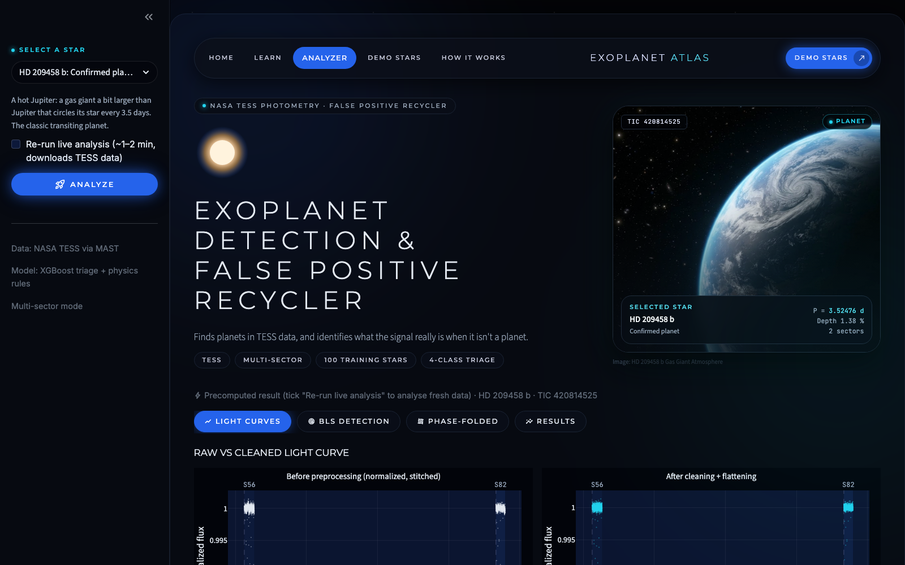<br><b>Analyzer</b>: pick a demo star in the sidebar, press <i>Analyze</i>; the selected star's card shows its class, period and depth.</td>
<td width="50%">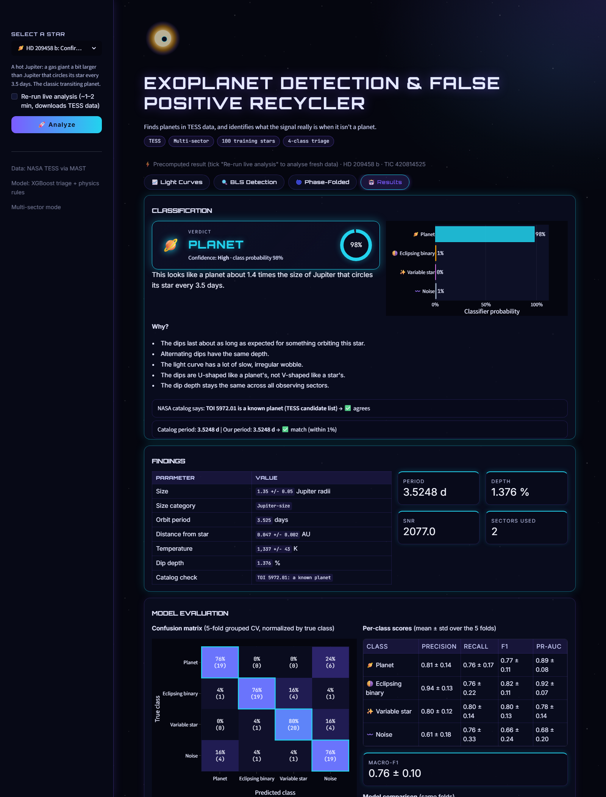<br><b>Results</b>: verdict with confidence, class probabilities, the <i>"Why?"</i> list, NASA catalog check, findings and model evaluation.</td>
</tr>
<tr>
<td>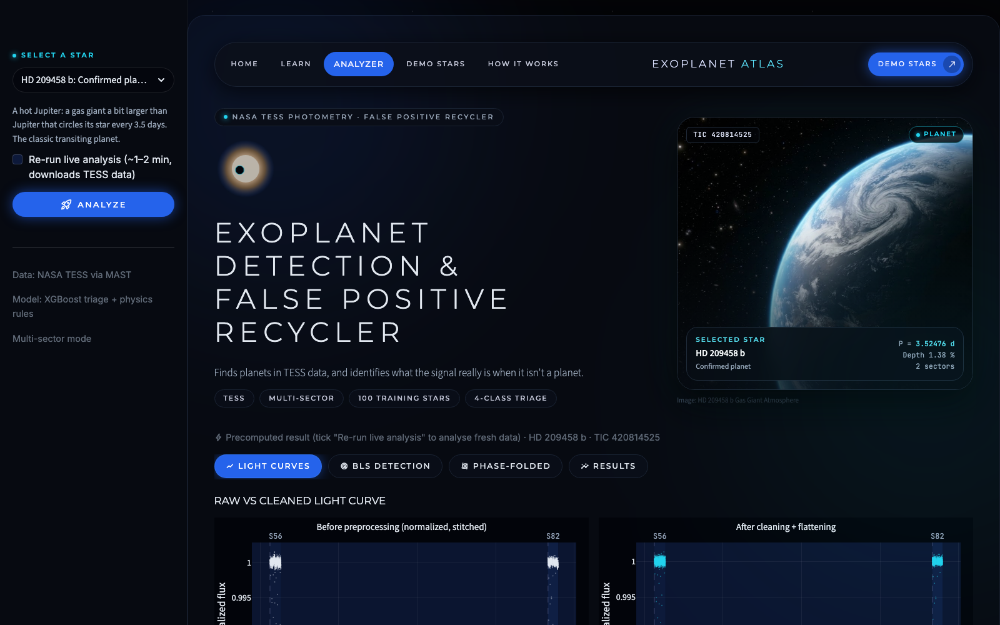<br><b>Light Curves</b>: raw versus cleaned light curve, sectors shaded.</td>
<td>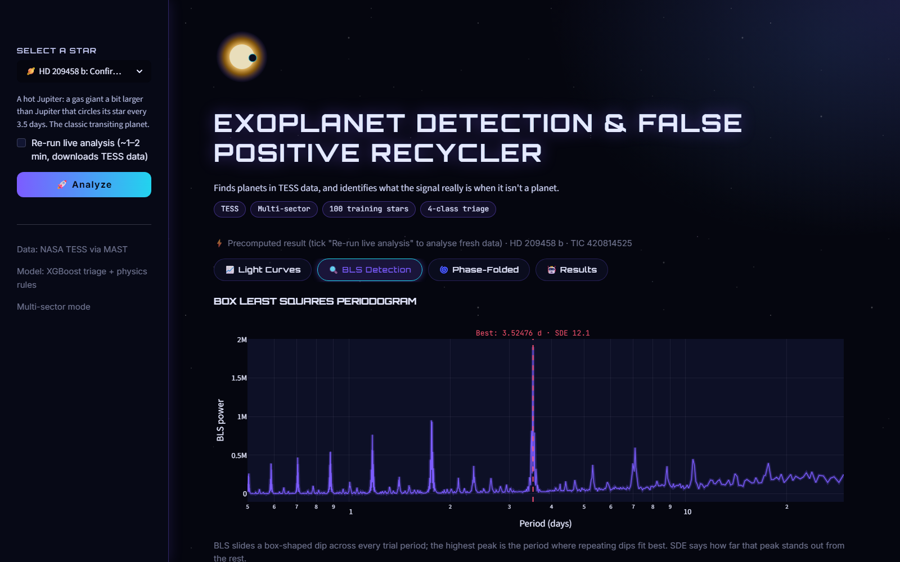<br><b>BLS Detection</b>: periodogram with the best period and its SDE.</td>
</tr>
<tr>
<td>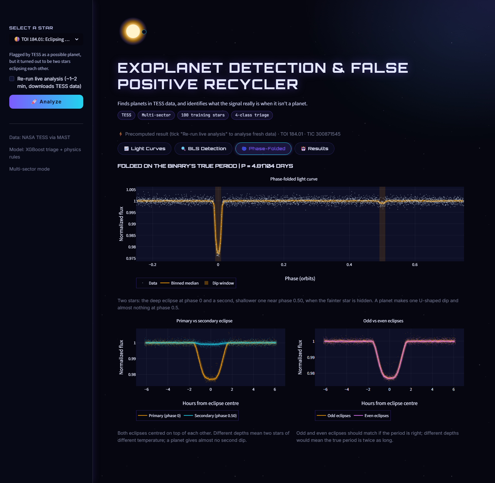<br><b>Phase-Folded</b>: TOI 184.01 folded on its true period, with primary vs secondary and odd vs even eclipses.</td>
<td>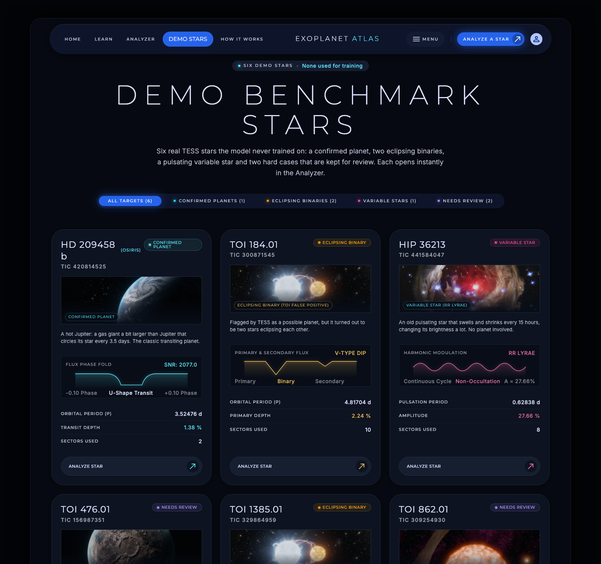<br><b>Demo Stars</b>: the six held-out stars with their real verdicts; each card opens the Analyzer.</td>
</tr>
<tr>
<td>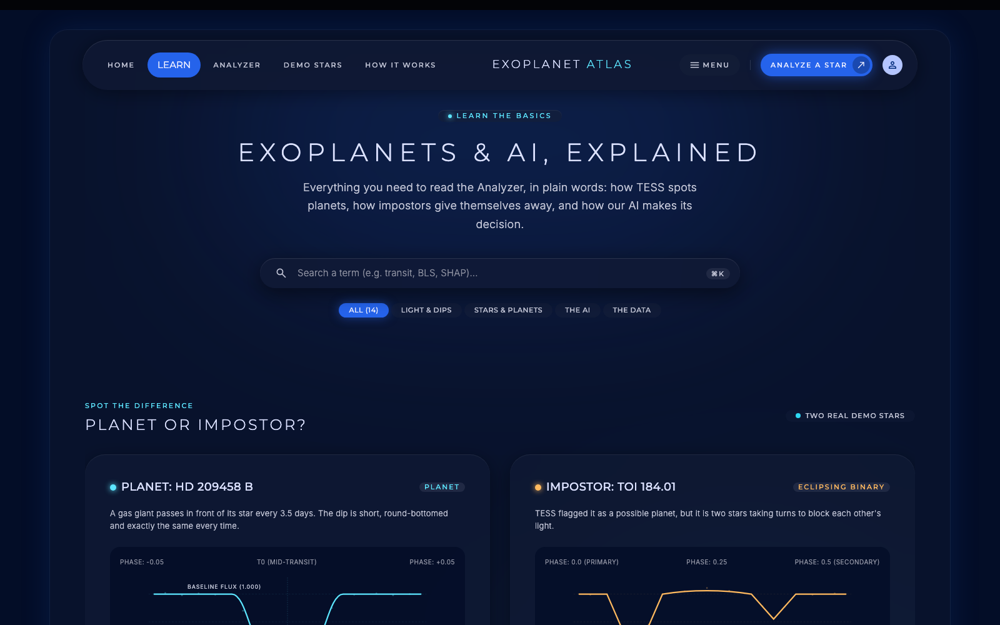<br><b>Learn</b>: a plain-language glossary of every idea the app uses, with real demo stars as examples.</td>
<td>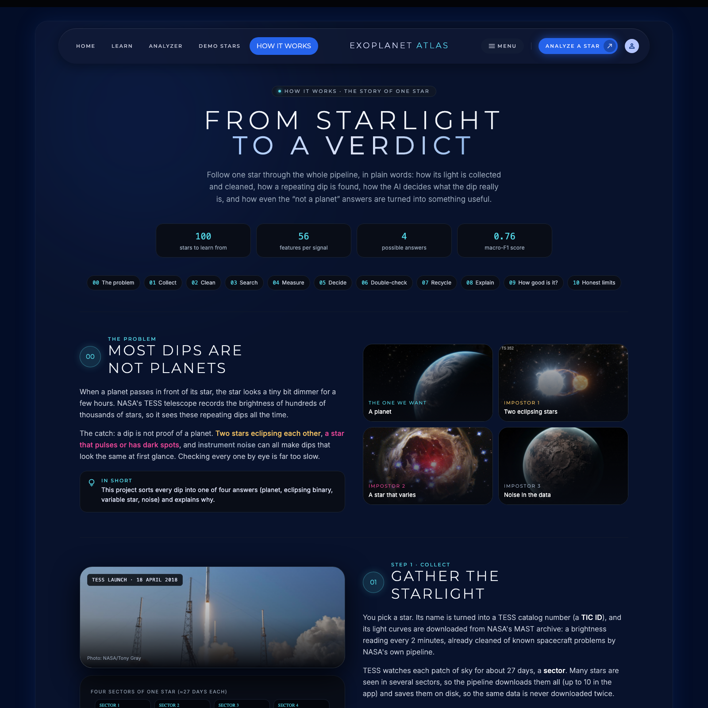<br><b>How It Works</b>: the pipeline told as the story of one star, with diagrams and the results.</td>
</tr>
</table>

---

## 🏗️ System architecture

<p align="center">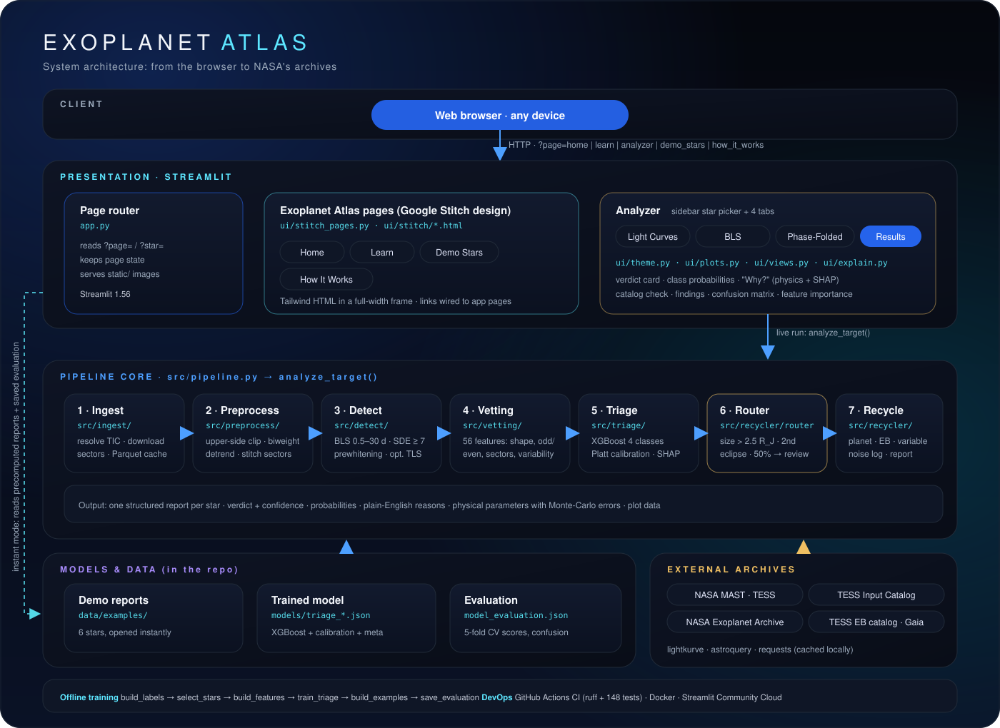</p>

| Layer | Responsibility | Main code |
|---|---|---|
| **Presentation** | Page routing, the Stitch-designed pages, the Analyzer with its four tabs | `app.py`, `ui/stitch_pages.py`, `ui/stitch/`, `ui/theme.py`, `ui/plots.py`, `ui/explain.py`, `ui/views.py` |
| **Pipeline core** | One star end to end: ingest → preprocess → detect → vetting → triage → router → recycler → report | `src/pipeline.py` and the `src/` packages |
| **Models and data** | Trained classifier with calibration, evaluation summary, six precomputed demo reports | `models/`, `data/examples/` |
| **External archives** | TESS light curves, TIC stellar parameters, TOI list, TESS EB catalog, Gaia DR3 variability | via `lightkurve`, `astroquery`, `requests` (cached locally) |
| **Offline training** | Labels, star selection, feature building, training, demo reports, evaluation | `scripts/` |

The Analyzer works in two modes: **instant** (reads a precomputed report and the saved
evaluation, works offline) and **live** (calls `src.pipeline.analyze_target`, which
runs the whole pipeline on fresh TESS data).

---

## 🔬 The pipeline

<p align="center">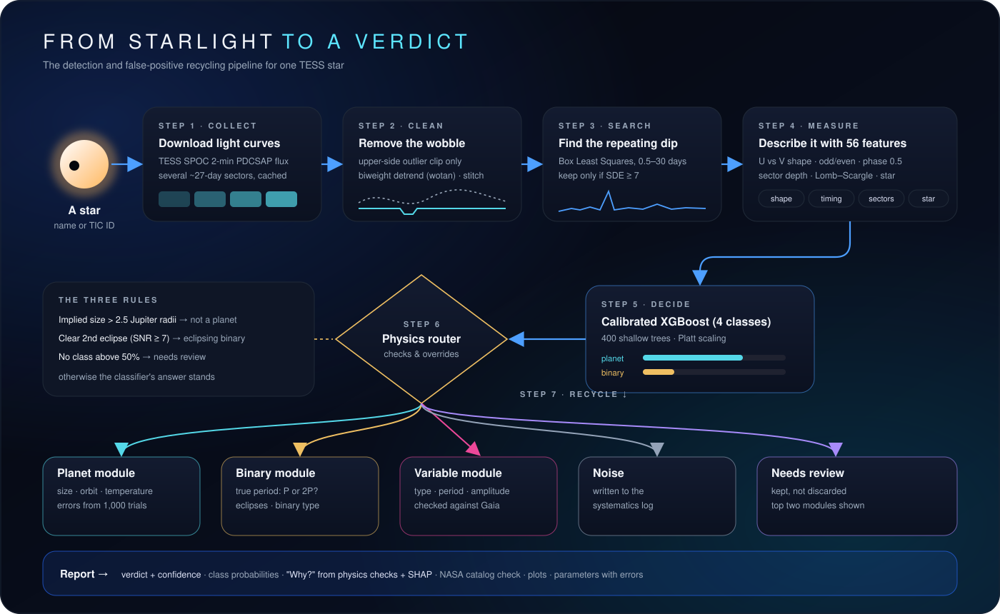</p>

| # | Stage | What happens | Module |
|---|---|---|---|
| 1 | **Collect** | Resolve the star to a TIC ID, list its sectors, download SPOC 2-minute PDCSAP light curves, cache them as Parquet | `src/ingest/` |
| 2 | **Clean** | Quality mask, per-sector median normalisation, upper-side-only 5σ clip, sliding biweight detrend (window ≥ 0.75 d, re-run with dips masked), stitch sectors | `src/preprocess/` |
| 3 | **Search** | Box Least Squares on the flattened, 10-min-binned curve: 0.5–30 days, 12 durations, coarse grid then refinement; SDE ≥ 7; prewhitened copy for fast variables | `src/detect/` |
| 4 | **Measure** | 56 features: trapezoid shape, odd/even, secondary eclipse, per-sector depth, Lomb–Scargle, autocorrelation, Fourier, stellar parameters | `src/vetting/` |
| 5 | **Decide** | Calibrated four-class XGBoost gives a probability for each class | `src/triage/` |
| 6 | **Double-check** | Physics router can overrule the classifier (see below) | `src/recycler/router.py` |
| 7 | **Recycle** | Planet, EB and variable modules characterise the signal; noise goes to a systematics log; every star is also checked for flares | `src/recycler/` |

### How the router decides

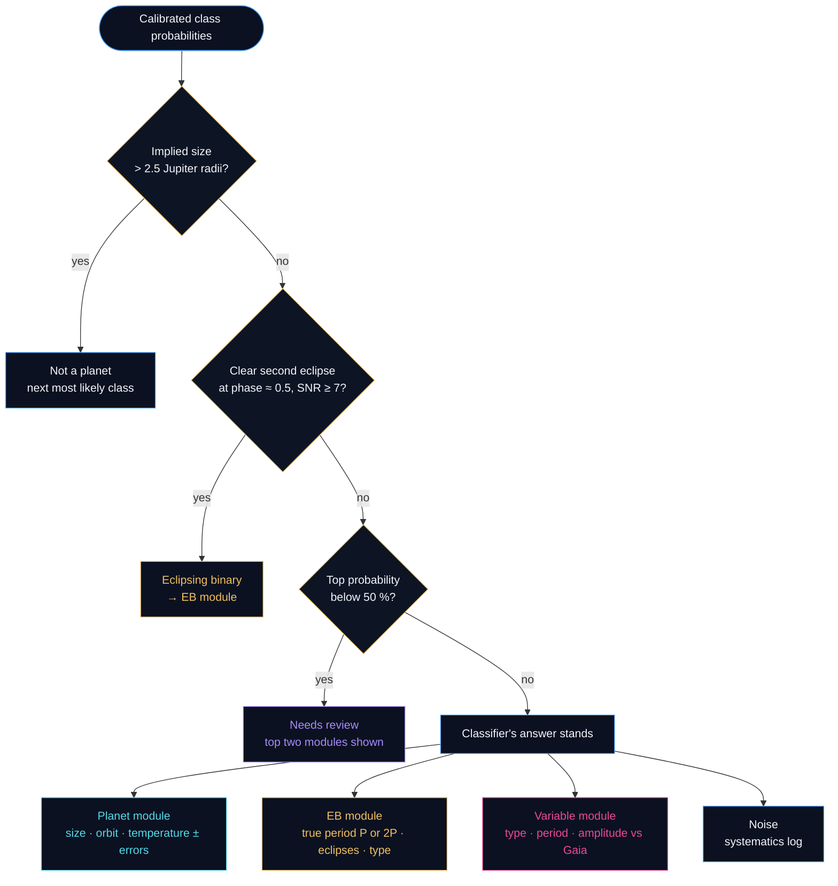

The router **never discards a possible planet**: if no class reaches 50 %, the star is
kept as *Needs review* and the findings of the two most likely modules are shown side
by side.

---

## 🗂️ Dataset

The dataset is **assembled by the pipeline itself** from public NASA and ESA archives,
not taken from a ready-made CSV. This avoids the circular training of the original
prototype, where a star's own features were used as both positive and negative
examples.

| Item | Details |
|---|---|
| Light curves | TESS SPOC 2-minute PDCSAP flux from MAST, via Lightkurve |
| Planet labels | NASA Exoplanet Archive TOI table, dispositions CP and KP, period 0.5–15 d |
| Eclipsing-binary labels | TESS Eclipsing Binary catalog (Prša et al. 2022), period 0.5–15 d |
| Variable-star labels | Gaia DR3 variability classification, cross-matched to TIC by position |
| Noise labels | TOI false alarms (FA) plus random 2-minute targets in none of the lists |
| Stellar parameters | TESS Input Catalog: Teff, radius, log g, Tmag, contamination ratio |
| Size | **400 stars, 100 per class**, brightness-matched; 6 more held out for the demo (the first model used 25 per class) |
| Domain | Tmag 8–12, two sectors per star (the two closest in time) |
| Split | No fixed split: 5-fold `StratifiedGroupKFold` grouped by TIC ID |

Labels are built by `scripts/build_labels.py`. When a star appears in several catalogs
a fixed priority is applied (confirmed planet > unconfirmed candidate > EB catalog >
Gaia variable > false alarm / random) and every conflict is logged. Unconfirmed
candidates are never used for training; they are kept as demo targets.
`scripts/select_stars.py` then draws 100 stars per class with **matched brightness**, so
no class can be recognised simply by how bright it is.

---

## 📐 Features

The 56 model features (full list in `models/triage_meta.json`) fall into five groups.
Values that grow with the amount of data (raw SNR, number of dips) are replaced by
per-transit or ratio versions, so the model behaves the same with 2 or 10 sectors.

| Group | Examples | What it captures |
|---|---|---|
| **Dip shape** | `depth_ppm`, `duty_cycle`, `ingress_to_total_ratio`, `duration_ratio_expected`, `implied_rp_rearth` | U- versus V-shaped dips; whether the duration and size fit an object orbiting *this* star |
| **Two-star tests** | `odd_even_depth_ratio`, `secondary_to_primary_ratio`, `ellip_amp_ppm`, `refl_amp_ppm` | Alternating eclipse depths, a second eclipse half an orbit later, ellipsoidal and reflection signals |
| **Consistency** | `sector_depth_cv`, `frac_sectors_with_transit`, `red_noise_beta` | Same depth in every sector, correlated noise on the dip timescale |
| **Variability** | `ls_period_1..3`, `ls_power_1..3`, `acf_period`, `acf_peak_height`, `fourier_R21`, `R31`, `phi21`, `phi31`, `skew`, `kurtosis` | Smooth stellar cycles (pulsation, rotation) found by Lomb–Scargle, autocorrelation and Fourier decomposition |
| **Star** | `teff`, `rad`, `logg`, `tmag`, `contratio` | The host star itself, from the TESS Input Catalog |

Missing values are left as `NaN` for XGBoost, which learns a default direction at each
split. The baselines get median imputation plus missing-value indicators. No PCA is
applied, because it would destroy the per-feature explanations.

---

## 🤖 Model and training

Three models were trained on **identical folds** (`StratifiedGroupKFold`, 5 folds,
seed 42). Grouping by TIC ID guarantees that no star appears on both sides of a split,
so every star is predicted exactly once by a model that never saw it.

| Model | Role | Key parameters |
|---|---|---|
| **XGBoost** *(selected)* | Main four-class classifier, native missing-value handling, exact TreeSHAP | `multi:softprob`, 400 trees, `max_depth=4`, `learning_rate=0.05`, `subsample=0.8`, `colsample_bytree=0.8`, `min_child_weight=2`, `reg_lambda=1.0` |
| Random forest | Non-linear baseline | 500 trees, `min_samples_leaf=2`, balanced subsample weights |
| Logistic regression | Linear baseline | `C=0.5`, balanced weights, `StandardScaler`, median imputation + indicators |

- **Conservative hyperparameters** (shallow trees, low learning rate, subsampling, L2):
  a grid search on a few hundred stars would mostly fit noise in the validation folds.
- **Calibration:** raw XGBoost scores are over-confident, so a per-class sigmoid
  (**Platt scaling**) is fitted on out-of-fold predictions, itself cross-validated.
  "70 % planet" then means roughly 7 in 10 such cases are planets.
- **Saving:** the final model is refitted on all 400 stars and saved as XGBoost JSON
  together with a metadata file holding the feature list, calibration curves,
  thresholds, training date and a hash of the label file.

---

## 📊 Results

### Model comparison (5-fold grouped CV, macro averages)

| Model | Accuracy | Precision | Recall | **F1** | PR-AUC | Log loss |
|---|:-:|:-:|:-:|:-:|:-:|:-:|
| **XGBoost (calibrated, used by the app)** | **0.87** | **0.88** | **0.87** | **0.87 ± 0.05** | 0.92 | **0.43** |
| Random forest | 0.84 | 0.85 | 0.84 | 0.84 ± 0.03 | 0.90 | 0.55 |
| SVM (RBF kernel) | 0.80 | 0.81 | 0.80 | 0.80 ± 0.04 | 0.87 | 0.54 |
| Logistic regression | 0.78 | 0.79 | 0.78 | 0.79 ± 0.04 | 0.84 | 0.73 |
| K-nearest neighbours (k = 9) | 0.72 | 0.73 | 0.72 | 0.71 ± 0.08 | 0.82 | 1.06 |

400 stars, 100 per class. The first model (100 stars) scored macro-F1 0.76 ± 0.10.
SVM and KNN need scaled, gap-free features (median imputation + standardisation, like
logistic regression); KNN suffers most from the 56 dimensions (it calls 32 noise stars
"planet"). Tree ensembles stay ahead on this small, partly missing table. Full metrics,
per-class F1 and confusion matrices: `scripts/compare_classifiers.py`
(`outputs/classifier_comparison.md`); the app's Model evaluation section shows them too.

### Ensembles and optimisation (none beat XGBoost alone)

| Experiment | Macro-F1 | vs XGBoost (0.871) | Script |
|---|:-:|:-:|---|
| Soft voting XGBoost + random forest | 0.866 ± 0.041 | -0.005 | `scripts/compare_ensembles.py` |
| Weighted soft voting XGBoost / RF / SVM (weights chosen by nested CV) | 0.864 ± 0.034 | -0.008 | `scripts/compare_ensembles.py` |
| Hard voting XGBoost + RF + SVM | 0.852 ± 0.022 | -0.019 | `scripts/compare_ensembles.py` |
| Hard voting, all 5 models | 0.832 ± 0.022 | -0.040 | `scripts/compare_ensembles.py` |
| Seed-bagged XGBoost (10 seeds) | 0.866 ± 0.046 | -0.005 | `scripts/compare_ensembles.py` |
| Hyperparameter tuning (RandomizedSearchCV, 40 settings, nested CV) | 0.839 ± 0.036 | -0.032 | `scripts/tune_xgboost.py` |
| Feature selection (SHAP ranking / RFE, k chosen by nested CV) | 0.868 ± 0.034 | ±0.00 (40 of 56 features are enough) | `scripts/select_features.py` |

Why: the models share most of their mistakes (of XGBoost's 52 errors, random forest
also makes 44), so voting has little to correct; a hard vote of XGBoost + RF + SVM can
fix 4 XGBoost errors but breaks 12 correct answers. With about 100 stars per inner
validation fold, tuned settings and voting weights mostly fit noise (they change from
fold to fold). The hand-chosen XGBoost settings and all 56 features are kept; the
feature-selection curve is shown in the app.

A study guide to all five models, feature scaling, ensembles and optimisation (what each is, what we did, the numbers and where the code is): [docs/MODELS_EXPLAINED.md](docs/MODELS_EXPLAINED.md).

### Per-class scores of the selected model (mean ± std over the folds)

| Class | Precision | Recall | F1 | PR-AUC |
|---|:-:|:-:|:-:|:-:|
| 🪐 Planet | 0.88 ± 0.04 | 0.87 ± 0.06 | 0.87 ± 0.04 | 0.95 ± 0.03 |
| 🌗 Eclipsing binary | 0.97 ± 0.03 | 0.91 ± 0.09 | 0.94 ± 0.04 | 0.96 ± 0.04 |
| ✨ Variable star | 0.86 ± 0.10 | 0.88 ± 0.08 | 0.87 ± 0.07 | 0.93 ± 0.06 |
| 〰️ Noise | 0.80 ± 0.09 | 0.82 ± 0.07 | 0.81 ± 0.06 | 0.84 ± 0.10 |

**Key observations**

- **No planet was ever called an eclipsing binary.** The main confusion is between
  shallow planets and noise (9 of 100 planets called noise, 8 noise stars called planet), and between variables and noise (11 variables called noise).
- With a threshold that lets through only **5 % of eclipsing binaries**, **88 % of real
  planets** are still kept (± 16 % between folds; 91 % pooled).
- XGBoost leads in every class; going from 100 to 400 stars helped noise most
  (F1 0.66 → 0.81) and halved the spread between folds.

### Pipeline and recycler checks

| Check | Result |
|---|---|
| Period recovered by BLS: planets | **89 / 100** (88 at the catalog period, 1 at half) |
| Period recovered by BLS: eclipsing binaries | **97 / 100** (73 at the true period, 24 at half) |
| Clear periodicity found: variable stars | **100 / 100** (false-alarm probability < 1 %) |
| EB true period after the P-vs-2P rule | 2 sectors per star: **16 / 25** unseen, 90 / 100 training. Up to 10 sectors (earlier set): **23 / 25** unseen |
| Variable-star type vs Gaia | **18 / 25** (earlier set; RR Lyrae 4/4, Cepheid 4/4, rotation 6/8) |
| EB configuration (detached / semi-detached / contact) | 31 / 50 (earlier sets); every miss is one step too "close" |
| Flares | 3 flare stars among the 400 (all cool dwarfs; none among planets or pulsators); about 9 in 10 flares of ~1 % or more recovered in injection tests |

### The six demo stars (never used for training)

| Star | True nature | Verdict | What it demonstrates |
|---|---|---|---|
| **HD 209458 b** | Confirmed planet | Planet (99 %) | The textbook case: 3.5248 d (catalog 3.5247 d), radius ≈ 1.35 R<sub>J</sub> |
| **TOI 184.01** | Eclipsing binary | Eclipsing binary (88 %) | Recycling: a TESS "planet candidate" that is two stars; the model calls it a binary and the second eclipse confirms it (the 100-star model leaned planet and needed the rule) |
| **HIP 36213** | RR Lyrae variable | Variable (98 %) | 0.6284 d, typed RR Lyrae, agrees with Gaia |
| **TOI 476.01** | Unconfirmed candidate | Planet (61 %, medium) | Leans planet, still unconfirmed by NASA (the 100-star model kept it for review at 47 %) |
| **TOI 1385.01** | Eclipsing binary | Eclipsing binary (79 %) | Known limitation: 4.52 d, half the true 9.05 d (equal eclipses) |
| **TOI 862.01** | Candidate on a variable star | Needs review | A small dip buried under the star's own variability |

---

## 💬 Explainable AI

Every verdict in the Results tab comes with a short **"Why?"** list in plain English:

1. **Physics checks first**, because they can overrule the model (for example *"A
   clear second eclipse was found halfway through the orbit, which planets don't
   produce"*).
2. **Then the features that pushed the model most**, from exact **TreeSHAP**
   contributions, turned into sentences such as *"The dips are U-shaped like a
   planet's, not V-shaped like a star's."*
3. **A NASA catalog check**: the verdict and the period are compared with the TOI list,
   the TESS EB catalog or Gaia, and disagreements are shown, not hidden.

Globally, the most influential features are the **autocorrelation peak height**,
**flux skewness**, the **ingress-to-total ratio** (U vs V shape) and the **observed vs
expected duration**. These match the physical intuition that shape and timing
separate planets from stars, which suggests the model has not learned a dataset
artefact.

---

## 🧰 Technology stack

| Area | Tools |
|---|---|
| Language | Python 3.13 (all versions pinned in `requirements.txt`) |
| Astronomy | Astropy (BLS, Lomb–Scargle), Lightkurve, Astroquery, Wotan |
| Data | NumPy, Pandas, PyArrow (Parquet), SciPy |
| Machine learning | XGBoost, scikit-learn, SHAP, Joblib |
| Visualisation | Plotly (interactive), Matplotlib (offline evaluation plots) |
| Web app | Streamlit 1.56, HTML/Tailwind pages designed in Google Stitch |
| Quality | pytest, Ruff |
| DevOps | Git, GitHub, GitHub Actions, Docker, Streamlit Community Cloud |

---

## 📁 Project structure

```
AIML_Exoplanet/
├── app.py                  Streamlit entry point: page routing + the Analyzer
├── config.py               all settings in one typed dataclass
├── src/
│   ├── ingest/             star lookup, TESS download + cache, catalogs
│   ├── preprocess/         cleaning, detrending, stitching sectors
│   ├── detect/             BLS search (optional TLS cross-check)
│   ├── vetting/            transit, variability and per-sector features
│   ├── triage/             labels, feature runner, training, model
│   ├── recycler/           router + planet / EB / variable / noise / flare modules
│   ├── pipeline.py         one star end to end (analyze_target)
│   └── demo_cache.py       precomputed demo reports
├── ui/
│   ├── theme.py            Analyzer look (CSS), verdict card, star card
│   ├── plots.py            Plotly figures
│   ├── views.py            plot views (folds, eclipses)
│   ├── explain.py          plain-English reasons from routing + SHAP
│   ├── stitch_pages.py     serves the Stitch pages, fills Demo Stars with real data
│   └── stitch/             Home, Learn, Demo Stars, How It Works (HTML)
├── static/stitch/          page images (credits in CREDITS.md)
├── scripts/                build labels / features / model / examples / evaluation, screenshots
├── models/                 triage_xgb.json, triage_meta.json, model_evaluation.json
├── data/examples/          the six precomputed demo reports
├── tests/                  offline test suite (synthetic light curves + app smoke tests)
├── docs/                   model card, architecture notes, diagrams, screenshots
├── Dockerfile · docker-compose.yml · .dockerignore
└── .github/workflows/ci.yml
```

---

## 🚀 Getting started

### 1. Local run

Requires **Python 3.12 or 3.13**.

<details open>
<summary><b>Linux / macOS</b></summary>

```bash
git clone https://github.com/AIML-Miniproj/AIML_Exoplanet.git
cd AIML_Exoplanet
python3 -m venv venv
source venv/bin/activate
pip install -r requirements.txt
streamlit run app.py
```
</details>

<details>
<summary><b>Windows (PowerShell)</b></summary>

```powershell
git clone https://github.com/AIML-Miniproj/AIML_Exoplanet.git
cd AIML_Exoplanet
python -m venv venv
venv\Scripts\activate
pip install -r requirements.txt
streamlit run app.py
```
</details>

Open <http://localhost:8501>. The app starts on **Home**; go to **Analyzer** (or click
a card on **Demo Stars**), pick a star and press **Analyze**. Tick *Re-run live
analysis* to download fresh TESS data (needs internet). The trained model and its
evaluation are committed in `models/`, so everything works straight after cloning.

### 2. Run with Docker

```bash
docker build -t exoplanet-atlas .
docker run -p 8501:8501 exoplanet-atlas
# or
docker compose up --build
```

The image (`python:3.13-slim`) contains the pinned dependencies, the trained model and
the demo reports, runs as a non-root user and has a health check; Compose keeps the
TESS download cache in a named volume.

### 3. Tests and linting

```bash
python -m pytest -q             # offline suite; network tests are deselected by default
python -m pytest -m network     # the few tests that query NASA's archives
ruff check .
```

---

## 🧪 Rebuilding everything from scratch

Downloaded data (`data/`, except `data/examples/`) and evaluation plots (`outputs/`)
are not in git; the trained model (`models/triage_xgb.json`, `models/triage_meta.json`,
which holds the calibration) and `models/model_evaluation.json` are. To rebuild
everything, run these in order. Times are for a laptop with 2 worker processes; scripts
that would run longer than 10 minutes stop and ask for `--confirm-long`.

| Step | Command | Time |
|---|---|---|
| 1. Labels from public catalogs (TOI list, TESS EB catalog, Gaia variables) | `python scripts/build_labels.py --limit-per-class 400` | a few minutes the first time (catalog downloads, then cached) |
| 2. Pick 100 stars per class | `python scripts/select_stars.py --per-class 100` | under a minute |
| 3. Run the pipeline on every training star | `python scripts/build_features.py --n-jobs 3 --confirm-long` | ~20 min for 400 stars with light curves cached; hours when every light curve must be downloaded |
| 4. Train and cross-validate | `python scripts/train_triage.py` | about a minute |
| 5. Precomputed demo reports | `python scripts/build_examples.py` | ~3 min |
| 6. Evaluation summary for the app (`models/model_evaluation.json`) | `python scripts/save_evaluation.py` | seconds |
| 7. *(optional)* README screenshots | `python scripts/take_screenshots.py` | ~1 min (needs Playwright) |

Model experiments (run after step 4 and before step 6, so the app's Model evaluation
shows them; each writes to `outputs/` only): `scripts/compare_classifiers.py` (SVM, KNN
and the baselines, ~1 min), `scripts/compare_ensembles.py` (voting, ~2 min),
`scripts/tune_xgboost.py` (nested hyperparameter search, ~1 min),
`scripts/select_features.py` (nested feature selection, ~4 min).

Optional checks: `scripts/eval_eb_period.py` (EB true-period accuracy),
`scripts/eval_eb_module.py`, `scripts/eval_recycler_rules.py`,
`scripts/check_verdicts.py`. The fresh EB set used by the period check comes from
`select_stars.py` and is built with
`python scripts/build_features.py --labels data/labels/fresh_eb_set.parquet --feature-set fresh_eb`.
All tunable settings (worker count, per-star timeout, period range, thresholds) live
in `config.py`.

Known data-access issues (October 2026): `tess.mit.edu` (the 2-minute target lists in
step 1) sends an incomplete SSL certificate chain, so Python's `requests` refuses it
while `curl` works; download the lists with `curl` into
`data/labels/raw/target_lists/S###.parquet` (columns `TICID, Tmag, RA, Dec`). MAST can
be slow and very large catalog queries may hang; every step caches per sector or per
star, so an interrupted step can simply be rerun.

---

## ⚙️ MLOps, testing and CI

| Practice | How it is done here |
|---|---|
| **Code versioning** | Git + GitHub; work arrives through pull requests into `main` |
| **Data versioning** | Raw data is not in git, but every model stores a hash of the label file it was trained on; the dataset can be rebuilt deterministically with the numbered scripts and a fixed seed |
| **Experiment tracking** | File-based: `models/triage_meta.json` (parameters, per-fold metrics, calibration, thresholds, top SHAP features) and `models/model_evaluation.json` |
| **Model versioning** | Model and metadata are committed together, so each git revision pins one exact model |
| **Automated testing** | 155 offline tests on synthetic light curves (preprocessing, detection, vetting, labels, triage, recycler, pipeline) plus app smoke tests for every page and demo star |
| **Continuous integration** | GitHub Actions runs Ruff and the test suite on **Ubuntu and Windows** for every push and pull request |
| **Containerisation** | `Dockerfile` + `docker-compose.yml` |
| **Monitoring** | Noise and needs-review signals are appended to a systematics log for later inspection |

---

## ☁️ Deployment

The app is set up for **Streamlit Community Cloud**, deployed straight from this repository:

| Setting | Value |
|---|---|
| Repository | `AIML-Miniproj/AIML_Exoplanet` |
| Branch | `main` |
| Main file | `app.py` |
| Python | 3.12 (Advanced settings) |

Streamlit Cloud installs `requirements.txt`, reads `.streamlit/config.toml` (dark
theme, static file serving for the page images) and redeploys automatically on every
push to `main`. For an organisation-owned repository, an organisation owner must first
grant the Streamlit OAuth app access (GitHub → Settings → Applications → Streamlit →
*Grant*).

---

## ⚠️ Limitations

- **Academic-scale dataset.** 400 stars (100 per class) give much steadier scores than
  the first 100, but there is no separate held-out test set yet; scores could shift by
  about ±0.05 on new stars.
- **Brightness only.** A fainter eclipsing binary blended with the target on the sky
  cannot be ruled out; that needs pixel-level or ground-based follow-up.
- **Equal-eclipse binaries.** When both eclipses look alike, the period comes out at
  half the true value (TOI 1385.01).
- **Starspot periods.** Spots evolve within weeks, so a rotation period can come out at
  a multiple of the true one.
- **Noise vs variable.** These classes overlap most; noise has the lowest F1, partly
  because Gaia screening was only possible for brighter stars.
- **Training domain.** 2-minute data, Tmag 8–12, periods up to 15 days. Outside this
  range, treat results with care.
- **Flares.** Very short flares (a few minutes) and flares on stars that vary by more
  than 10 % are not reliably found; flare energies are approximate.

Within these limits the system is suitable as a **first-pass triage and teaching
tool**, not as a replacement for expert vetting.

---

## 🔮 Future scope

- **More data:** scale from 400 to thousands of labelled stars with the existing label
  scripts, and add a true held-out test set (already feasible at 400).
- **Deep learning:** add a 1-D CNN on global and local phase-folded views and ensemble
  it with the feature model.
- **Pixel-level vetting:** centroid shifts from target pixel files to rule out blended
  binaries.
- **Better recyclers:** eclipse-timing variations for third bodies, smarter
  equal-eclipse handling, a trained variable-star sub-classifier.
- **Wider domain:** 200-second and 30-minute full-frame-image light curves, fainter
  stars, longer periods.
- **MLOps:** MLflow tracking and registry, DVC data versioning, scheduled retraining
  as new TESS sectors and TOI dispositions arrive.
- **Serving:** a REST API (e.g. FastAPI), batch processing of whole sectors and drift
  monitoring.

---

## 📚 References

1. G. R. Ricker et al., "Transiting Exoplanet Survey Satellite," *J. Astron. Telesc. Instrum. Syst.*, 1(1), 014003, 2015.
2. G. Kovács, S. Zucker and T. Mazeh, "A box-fitting algorithm in the search for periodic transits," *A&A*, 391, 369–377, 2002.
3. S. D. McCauliff et al., "Automatic classification of Kepler planetary transit candidates," *ApJ*, 806(1), 6, 2015.
4. C. J. Shallue and A. Vanderburg, "Identifying exoplanets with deep learning," *AJ*, 155(2), 94, 2018.
5. M. Ansdell et al., "Scientific domain knowledge improves exoplanet transit classification with deep learning," *ApJL*, 869(1), L7, 2018.
6. L. Yu et al., "Identifying exoplanets with deep learning. III. Automated triage and vetting of TESS candidates," *AJ*, 158(1), 25, 2019.
7. H. P. Osborn et al., "Rapid classification of TESS planet candidates with convolutional neural networks," *A&A*, 633, A53, 2020.
8. D. J. Armstrong, J. Gamper and T. Damoulas, "Exoplanet validation with machine learning: 50 new validated Kepler planets," *MNRAS*, 504(4), 5327–5354, 2021.
9. M. Hippke et al., "Wōtan: Comprehensive time-series detrending in Python," *AJ*, 158(4), 143, 2019.
10. N. R. Lomb, *Ap&SS*, 39, 447–462, 1976; J. D. Scargle, *ApJ*, 263, 835–853, 1982.
11. T. Chen and C. Guestrin, "XGBoost: A scalable tree boosting system," *KDD*, 785–794, 2016.
12. S. M. Lundberg and S.-I. Lee, "A unified approach to interpreting model predictions," *NeurIPS 30*, 4765–4774, 2017.
13. J. Platt, "Probabilistic outputs for support vector machines…," *Advances in Large Margin Classifiers*, MIT Press, 1999.
14. A. Prša et al., "TESS eclipsing binary stars. I.," *ApJS*, 258(1), 16, 2022.
15. L. Eyer et al., "Gaia Data Release 3: Summary of the variability processing and analysis," *A&A*, 674, A13, 2023.

The full reference list is in the project report; model details are in
[`docs/MODEL_CARD.md`](docs/MODEL_CARD.md) and design notes in
[`docs/ARCHITECTURE.md`](docs/ARCHITECTURE.md).

---

## 🙏 Credits and acknowledgements

- **Data:** NASA TESS mission, the Mikulski Archive for Space Telescopes (MAST), the
  NASA Exoplanet Archive (TOI table), the TESS Eclipsing Binary catalog and ESA Gaia
  DR3.
- **Images:** NASA Image and Video Library (V838 Monocerotis light echo:
  NASA/ESA/H. E. Bond; PIA26601: NASA/JPL-Caltech; TESS launch: NASA/Tony Gray) and
  images from the Google Stitch export. Full credits in
  [`static/stitch/CREDITS.md`](static/stitch/CREDITS.md).
- **Page design:** "Exoplanet Atlas" interface designed in Google Stitch.

**Mini project:** Third Year B.Tech (Computer Engineering), MKSSS's Cummins College of
Engineering for Women, Pune · Academic Year 2026–27.
**Contributors:** [@mahi-mahalle](https://github.com/mahi-mahalle) ·
[@Dkhatke](https://github.com/Dkhatke)

<details>
<summary><b>Cite this project</b></summary>

```bibtex
@misc{exoplanet_atlas_2026,
  title  = {Exoplanet Detection and False-Positive Recycling in TESS Light Curves
            using XGBoost and Physics-Based Vetting},
  author = {Mahalle, Mahi and contributors},
  year   = {2026},
  note   = {Mini project, Cummins College of Engineering for Women, Pune},
  url    = {https://github.com/AIML-Miniproj/AIML_Exoplanet}
}
```
</details>

<div align="center"><sub>Built with real NASA data · explained in plain language · honest about its limits</sub></div>
