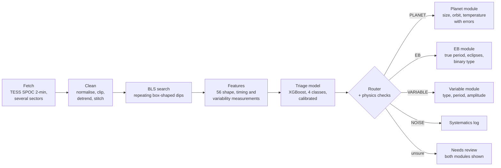

# Exoplanet Detection & False Positive Recycler

Finds transiting exoplanets in multi-sector TESS light curves. Most repeating dips
are not planets, so instead of throwing those away the pipeline "recycles" them:
a classifier plus physics rules decides whether the signal is a planet, an
eclipsing binary, a variable star or noise, and a dedicated module then describes
what it found (planet size and orbit, the binary's true period and type, or the
variable star's type and period).

An academic project: 100 training stars (25 per class), a six-star demo app, and
an honest account of where it fails.

## Screenshots

| Results | Light curves |
|---|---|
|  |  |

| Phase-folded | BLS detection |
|---|---|
|  |  |

## Pipeline



The router can override the classifier with physics: an implied size above 2.5
Jupiter radii cannot be a planet, and a clear second eclipse halfway through the
orbit means two stars. Anything with no class above 50% is kept as **Needs review**
rather than discarded.

## The six demo stars

All six open instantly from precomputed reports; none of them was used for training.

| Star | Type | What it demonstrates |
|---|---|---|
| HD 209458 b | Confirmed planet | The textbook case: a clean U-shaped dip every 3.5 days, classified Planet (High), size about 1.35 Jupiter radii |
| TOI 184.01 | Eclipsing binary (TOI false positive) | Recycling: the classifier alone leans towards planet, but a clear second eclipse at phase 0.5 makes the router call it an eclipsing binary |
| HIP 36213 | Variable star (RR Lyrae) | A star that changes on its own: found by the Lomb-Scargle periodogram (0.628 d) and typed as RR Lyrae, agreeing with Gaia |
| TOI 476.01 | Unconfirmed planet candidate | Honest uncertainty: planet 47% vs variable 20%, so it is kept for review and both the planet and variable findings are shown |
| TOI 1385.01 | Tricky case (binary, period ambiguous) | Two nearly equal eclipses: correctly called an eclipsing binary, but at 4.52 d, half the catalog's 9.05 d |
| TOI 862.01 | Tricky case (transit hidden by star's variability) | A possible small transit buried under the star's own brightness changes; the pipeline cannot separate them and marks it for review |

## Results

Evaluated with 5-fold cross-validation grouped by star (every star is scored once
by a model that never saw it); numbers are mean ± standard deviation over the folds.

| Metric | Value |
|---|---|
| Macro-F1 (XGBoost, calibrated) | **0.76 ± 0.10** |
| F1, planet | 0.77 ± 0.11 |
| F1, eclipsing binary | 0.82 ± 0.11 |
| F1, variable star | 0.80 ± 0.13 |
| F1, noise | 0.66 ± 0.24 |
| Planet recall | 0.76 ± 0.17 (19 of 25 planets) |
| Baselines (macro-F1) | random forest 0.71 ± 0.12, logistic regression 0.63 ± 0.09 |
| Signal recovered by the search | planets 25/25, binaries 25/25 (15 at the true period, 10 at half), variables 25/25 |
| EB true period after the P vs 2P rule | **23/25** on fresh binaries never used in design, 22/25 on the training binaries |
| Variable type vs Gaia | 18/25 agree |
| Binary type (detached / semi-detached / contact) | 31/50 (misses are always one step too "close") |

### Limitations

- **Small dataset.** 100 stars show that the method works; they are not enough to
  rely on it. Expect real-world numbers to vary by about ±0.1.
- **Brightness only.** The pipeline uses flux measurements only. It cannot rule out
  that a dip comes from a fainter eclipsing binary next to the target on the sky;
  that needs pixel-level or ground-based follow-up.
- **Starspot periods.** Spots grow and fade within weeks, so a spotted star's
  period can come out at a multiple of the true rotation period.
- **Equal-eclipse binaries.** When both eclipses are almost the same depth, the
  binary looks like one dip at half the orbit (TOI 1385.01). The EB module only
  doubles the period when it sees a difference between alternate eclipses.
- **Noise vs variable.** The noise class was screened against known variables only
  for brighter stars, so these two classes overlap the most (noise F1 is lowest).
- **Training domain.** 2-minute data, 2 sectors, TESS magnitude 8-12, periods
  0.5-15 days. Fainter stars and longer periods are outside what it has seen.

Full details are in [docs/MODEL_CARD.md](docs/MODEL_CARD.md).

## Setup and run

Python 3.13.

**Windows (PowerShell)**
```powershell
python -m venv venv
venv\Scripts\activate
pip install -r requirements.txt
streamlit run app.py
```

**Linux / macOS**
```bash
python3 -m venv venv
source venv/bin/activate
pip install -r requirements.txt
streamlit run app.py
```

Open http://localhost:8501, pick a star in the sidebar and click **Analyze**. Tick
"Re-run live analysis" to download fresh TESS data and analyse it (about 1-2 min;
needs internet). The live verdict and the Results tab's model evaluation need the
trained model and saved results (see below); the six precomputed demos work
without them.

Tests (offline, about 4-6 min):
```bash
python -m pytest -q             # network tests are deselected by default
python -m pytest -m network     # the few tests that query NASA's archives
ruff check .
```

## For developers: rebuilding everything

Downloaded data (`data/`, except `data/examples/`), the model (`models/`) and
evaluation outputs (`outputs/`) are not in git. Rebuild them in this order. Times
are for a laptop with 2 worker processes; scripts that would run longer than 10
minutes stop and ask for `--confirm-long`.

| Step | Command | Time |
|---|---|---|
| 1. Labels from public catalogs (TOI list, TESS EB catalog, Gaia variables) | `python scripts/build_labels.py` | a few minutes the first time (catalog downloads, then cached) |
| 2. Pick 25 stars per class | `python scripts/select_stars.py` | under a minute |
| 3. Run the pipeline on every training star | `python scripts/build_features.py` | ~8 min with light curves cached; over an hour when every light curve must be downloaded |
| 4. Train and cross-validate | `python scripts/train_triage.py` | about a minute |
| 5. Precomputed demo reports | `python scripts/build_examples.py` | ~3 min |
| 6. Evaluation summary for the app | `python scripts/save_evaluation.py` | seconds |

Optional checks: `scripts/eval_eb_period.py` (EB true-period accuracy),
`scripts/eval_eb_module.py`, `scripts/eval_recycler_rules.py`,
`scripts/check_verdicts.py`. The fresh EB set used by the period check comes from
`select_stars.py` and is built with
`python scripts/build_features.py --labels data/labels/fresh_eb_set.parquet --feature-set fresh_eb`.

All tunable settings (worker count, per-star timeout, period range, thresholds)
live in `config.py`.

## Project structure

```
app.py                  Streamlit app (sidebar + 4 tabs)
config.py               all settings in one typed dataclass
src/
  ingest/               star lookup, TESS download + cache, catalogs
  preprocess/           cleaning, detrending, stitching sectors
  detect/               BLS search (optional TLS cross-check)
  vetting/              transit, variability and per-sector features
  triage/               labels, feature runner, training, model
  recycler/             router + planet / EB / variable / noise modules
  pipeline.py           one star end to end
  demo_cache.py         precomputed demo reports
ui/                     theme (CSS), plots, plot views, plain-English reasons
scripts/                build labels / features / model / examples / evaluation
tests/                  offline test suite (synthetic light curves)
data/examples/          the six precomputed demo reports (committed)
docs/                   model card, architecture, screenshots
.github/workflows/      CI: ruff + offline tests on Ubuntu and Windows
```
